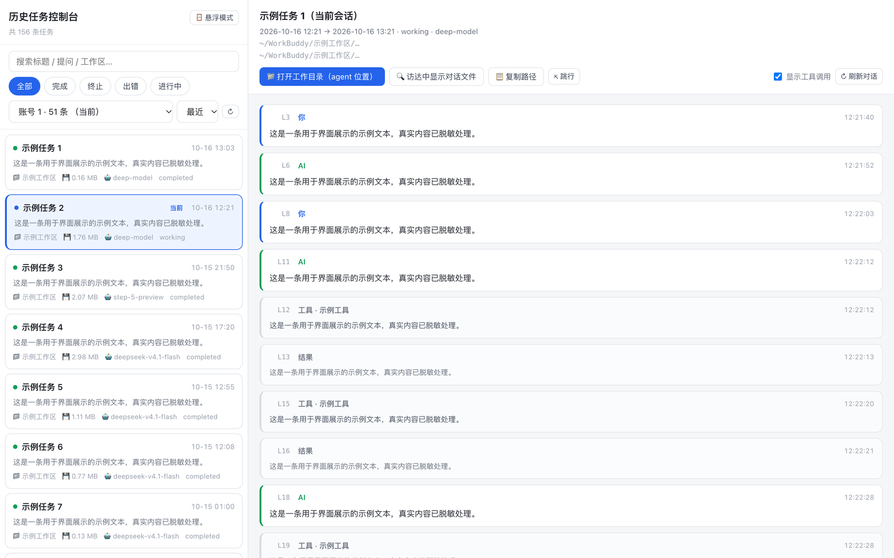
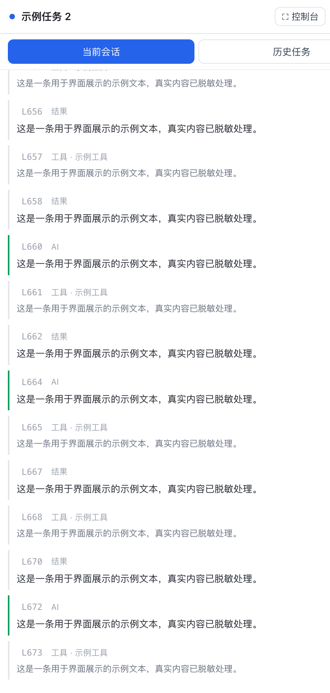

# Workbuddy-Agent-Historical-Task-Location-Program

> 别名 `wb-history-console` —— 把 WorkBuddy 里**你发过的每一个历史任务**翻出来，
> 做成可搜索的控制台，并且能一键**定位回那个任务当时的位置**：
> 它所在的 agent 工作目录，以及对话流水的精确行号。

---

## 两种模式

本仓库同时提供**两种使用形态，代码里各有一份完整实现**：

### 模式 A — 控制台（完整双栏）



```bash
python3 server.py --port 8901      # 或双击 start.command
# 打开 http://127.0.0.1:8901/
```

左栏任务列表 + 右栏完整对话回放。适合坐下来翻、搜索、定位。

### 模式 B — 悬浮面板（贴屏幕右侧，始终置顶）



```bash
bash swift/build.sh                 # 一键编译成 .app
open build/WBHistoryPanel.app       # 或双击 start-panel.command
# 面板内加载 http://127.0.0.1:8901/float
```

菜单栏出现「**会话**」，单击显示/隐藏。默认展示**当前会话**的实时对话，
切到「历史任务」可搜索并点开任意一条。适合边干活边瞄一眼。

两种方式**共用同一份后端**（`server.py`）与**同一套数据层**（`wbhistory.py`），
只是前端入口不同：`/` 是控制台，`/float` 是悬浮面板。
两个页面上都提供了切到另一种模式的按钮。

> 纯 Python 标准库 + 原生 Swift，**零第三方依赖**。

---

## 为什么会有这个项目

WorkBuddy 的界面里，右侧「结果区」是内置的（概览 / 产物），
插件体系只有**连接器 / 专家 / 技能**三类，**没有开放给第三方的 UI 面板扩展点**——
所以做不出「插进 WorkBuddy 右边」的插件。

退而求其次的解法：**做一个系统级的悬浮面板**。它始终置顶、贴在屏幕右侧，
视觉上就挨着 WorkBuddy 右边，随时点开就能看当前会话在聊什么，也能回看历史任务。

## 能力

| 能力 | 说明 |
|---|---|
| 历史任务总览 | 列出全部会话：标题、时间、状态、工作区、模型、对话体积 |
| 全文搜索 | 搜标题、**你当初的原始提问**、工作区名 |
| 完整对话回放 | 逐条还原 user / assistant / 工具调用，含时间戳 |
| **定位到 agent 位置** | 一键打开该任务当时的工作目录（访达） |
| **定位到对话位置** | 每条消息标了在对话文件中的行号 `L123`，点击用编辑器打开到那一行 |
| 多账号 | 同一台机器上的多个 WorkBuddy 账号可切换查看 |
| 当前会话跟随 | 自动识别正在进行的会话，实时刷新 |
| 悬浮面板 | macOS 菜单栏常驻，点击唤出一个贴右侧的置顶面板 |

## 快速开始

### 1. 控制台（网页）

```bash
python3 server.py --port 8901
```

会自动打开 `http://127.0.0.1:8901`。也可以直接双击 `start.command`。

### 2. 悬浮面板（macOS）

```bash
bash swift/build.sh
open build/WBHistoryPanel.app
```

菜单栏会出现「**会话**」：

- 单击 → 显示 / 隐藏面板
- 面板顶部左侧区域可拖动；底部有「控制台 / 刷新 / 复位 / 隐藏」
- 面板默认展示**当前会话**，切到「历史任务」可搜索并点开任意一条

> `.app` 已把 `server.py`、`wbhistory.py`、`web/` 打包进去，
> 面板会**自动拉起本地服务**（端口不通时自己启动脚本），双击即用。

## 定位是怎么做的

每条消息在读取时都会记下它在对话文件里的**行号**：

```
L6    assistant   我来帮你定位 …
L12   tool        Bash · ls -la ~/.workbuddy/
```

- 点行号 → 用 VS Code / Cursor / Sublime 打开 `文件:行号`（都没装则退到文本编辑）
- 「打开工作目录」→ 在访达里打开该任务当时的 `cwd`
- 「访达中显示对话文件」→ 直接选中那个 `.jsonl`

出于安全，`/api/locate` 只会操作 WorkBuddy 数据目录与已知任务工作目录内的路径，
其他路径一律拒绝（例如传 `/etc/passwd` 会返回拒绝）。

## 数据来源（全部在本机）

```
~/.workbuddy/workbuddy.db                    → sessions 表：任务元数据
~/.workbuddy/projects/<项目>/<id>.jsonl       → 完整对话流水
```

只读，不写、不改、不删任何 WorkBuddy 数据。

已知的结构细节（便于你二次开发）：

- `sessions` 表关键字段：`id / cwd / user_id / title / status / created_at / updated_at / model / expert_id`
- 时间戳是**毫秒**；`status` 取值 `completed / terminated / error / working`
- `.jsonl` 每行一条记录，靠 **`role` 字段**（不是 `type`）区分 user / assistant
- 用户消息里混着大段系统注入（`<system-reminder>`、`<user_info>` 等），
  真正的人话包在 `<user_query>` 里 —— `wbhistory.strip_noise()` 负责剥离

## 命令行用法

```bash
python3 wbhistory.py        # 打印任务统计、当前会话、前几条消息
```

```python
import wbhistory as W

W.list_tasks()                  # 全部任务
W.detect_current_session()      # 当前会话
W.load_messages(session_id)     # 对话（每条带行号）
W.first_prompt(session_id)      # 首条真实提问
```

## 环境变量

| 变量 | 默认 | 作用 |
|---|---|---|
| `WB_HISTORY_PORT` | `8901` | 服务端口 |
| `WB_SESSION_ID` | 自动识别 | 强制指定「当前会话」 |
| `WB_SESSION_CWD` | 自动识别 | 用工作目录匹配当前会话 |
| `WB_HOME` | `~/.workbuddy` | WorkBuddy 配置目录（便于测试） |

## 目录结构

```
wb-history-console/
├── wbhistory.py       数据层：读库、解析对话、行号索引、文本清洗
├── server.py          本地 HTTP 服务与 API
├── web/               前端：控制台 + 悬浮面板页面
├── swift/             macOS 原生悬浮面板（NSPanel + WKWebView）
│   ├── Panel.swift
│   └── build.sh       一键编译成 .app
├── start.command      双击启动控制台（模式 A）
├── start-panel.command 双击编译并启动悬浮面板（模式 B）
├── scripts/
│   ├── smoke_test.py  端到端冒烟测试
│   └── screenshot.py  生成 README 展示截图（demo 模式）
└── docs/screenshots/  README 里用到的界面截图（已脱敏）
```

## 重新生成 README 里的截图

```bash
python3 scripts/screenshot.py
```

用无头 Chrome 打开 **`?demo=1` 演示模式**截图 —— 该模式下真实任务标题、
原始提问、工作区、本地路径、账号 id 会被**整体替换**成占位文本，
所以截图**天然不含任何个人信息**，可直接放进公开仓库，无需手工打码。

## 隐私

- **纯本地**：只读取你本机的 WorkBuddy 数据，不联网、不上传、不写入。
- 源码中**不含任何个人路径**——所有路径都在运行时通过 `expanduser("~")` 解析。
- 仓库的 `.gitignore` 已排除 `data.json`、`.jsonl` 等含真实对话内容的产物，
  克隆本仓库不会带出任何人的历史记录。

## 环境要求

- macOS（悬浮面板）；控制台部分纯 Python，其他系统也能跑
- Python 3.9+
- 悬浮面板需要 Swift 编译环境（Xcode Command Line Tools）

## License

MIT
